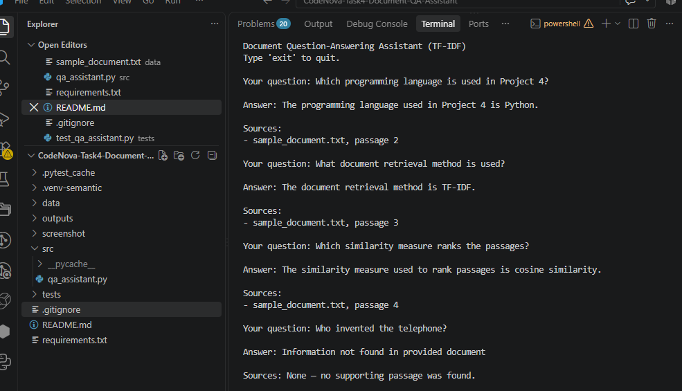

# Semantic Document Question-Answering Assistant

A Python-based Document Question-Answering Assistant that retrieves relevant information from local text documents using **semantic chunking, TF-IDF vectorization, and cosine similarity**. It returns document-grounded answers with source citations and handles unsupported questions transparently.

## Project Overview

This project was developed as part of the CodeNova AI/ML Internship.

The assistant ingests local text documents, groups semantically related sentences into passages using a free local Sentence-Transformers model, and retrieves relevant passages using TF-IDF and cosine similarity.

It returns extracted text from the source documents instead of generating unsupported facts.

The project runs locally using free, open-source tools and does not require paid API keys.

## Features

- Loads local `.txt` documents from the `data/` folder.
- Uses the `all-MiniLM-L6-v2` Sentence-Transformers model to compare sentence meanings.
- Groups semantically related adjacent sentences into passages.
- Preserves paragraph boundaries and targets approximately 60 words per passage.
- Uses **TF-IDF vectorization** for question and passage representation.
- Ranks passages using **cosine similarity**.
- Returns relevant extracted text from retrieved passages.
- Displays source filenames and passage numbers.
- Returns `Information not found in provided document` when no sufficiently relevant passage is found.
- Includes automated unit tests.
- Operates locally without paid API dependencies.

## Technologies Used

- Python 3
- Sentence-Transformers (`all-MiniLM-L6-v2`) for semantic sentence embeddings
- scikit-learn (`TfidfVectorizer` and cosine similarity)
- PyTorch (model inference dependency)
- Python standard library
- pytest and unittest for testing

## Project Structure

```text
CodeNova-Task4-Document-QA-Assistant/
├── data/
│   └── sample_document.txt
├── src/
│   └── qa_assistant.py
├── tests/
│   └── test_qa_assistant.py
├── screenshot/
│   └── task4-execution.png
├── outputs/
├── requirements.txt
├── .gitignore
└── README.md
```

## Requirements

- Python 3.10 or newer
- Internet access for the initial package and model download
- Sufficient disk space for the Python dependencies and model

The Sentence-Transformers model is downloaded automatically the first time the assistant runs. After downloading, model inference can run locally without a paid API or sending document contents to an external service.

## Installation and Setup

### 1. Clone the repository

```bash
git clone https://github.com/anjaliyama4/CodeNova-Task4-Document-QA-Assistant.git
cd CodeNova-Task4-Document-QA-Assistant
```

### 2. Create a virtual environment

Windows PowerShell:

```powershell
py -m venv .venv
```

### 3. Install dependencies

```powershell
.\.venv\Scripts\python.exe -m pip install -r requirements.txt
```

### 4. Check Python

```powershell
py --version
```

## How to Run

Start the assistant from the project root:

```powershell
.\.venv\Scripts\python.exe -m src.qa_assistant
```

Enter a question when prompted. Type `exit` to close the assistant.

## Example Questions and Results

**Question:** Which programming language is used in Project 4?

**Answer:** The programming language used in Project 4 is Python.

**Source:** `sample_document.txt`, passage 2

---

**Question:** What retrieval method does the assistant use?

**Answer:** The document retrieval method is TF-IDF.

**Source:** `sample_document.txt`, passage 3

---

**Question:** What is the capital of Mars?

**Answer:** `Information not found in provided document`

**Source:** None

The passage numbers correspond to the passages created from the sample document. Actual passage grouping and numbering depend on the document content and semantic chunking results.

## Run Automated Tests

Run the tests from the project root:

```powershell
.\.venv\Scripts\python.exe -m pytest -q
```

The test suite covers:

- Relevant project questions
- Tool-related questions
- Unsupported questions
- Empty questions
- Source filename preservation

## How It Works

1. **Document ingestion:** Reads `.txt` documents from the local `data/` directory.
2. **Sentence extraction:** Identifies sentences while preserving paragraph boundaries.
3. **Semantic chunking:** Uses `all-MiniLM-L6-v2` sentence embeddings to compare adjacent sentence meanings and group related sentences into passages, subject to a word-count target.
4. **Question processing:** Converts the user question into a TF-IDF vector.
5. **Passage retrieval:** Uses cosine similarity to rank document passages by relevance.
6. **Answer selection:** Returns extracted text from the most relevant passage.
7. **Source citation:** Displays the source filename and passage number.
8. **Fallback handling:** Returns `Information not found in provided document` when the question is empty or no sufficiently relevant passage is found.

## Limitations

- The current implementation supports plain-text `.txt` files only.
- Semantic chunking compares adjacent sentences; it does not perform global topic clustering.
- Passage grouping depends on the embedding model and similarity threshold.
- Retrieval uses TF-IDF, which may not recognize every question expressed using very different vocabulary.
- The assistant returns extracted passage text rather than generating natural-language answers.
- A similarity score alone does not guarantee factual correctness; answers should be checked against the source document.

## Future Improvements

- Support PDF and Word document ingestion.
- Explore semantic retrieval using sentence embeddings.
- Improve passage ranking and answer extraction.
- Expand automated tests with additional question types.
- Add an optional web interface.

## Internship Project

**Program:** CodeNova AI/ML Internship  
**Project:** Document Question-Answering Assistant

This project demonstrates local document ingestion, meaning-aware semantic chunking, TF-IDF-based information retrieval, source citations, and transparent handling of unsupported questions using free, open-source tools.

## Execution Screenshot


